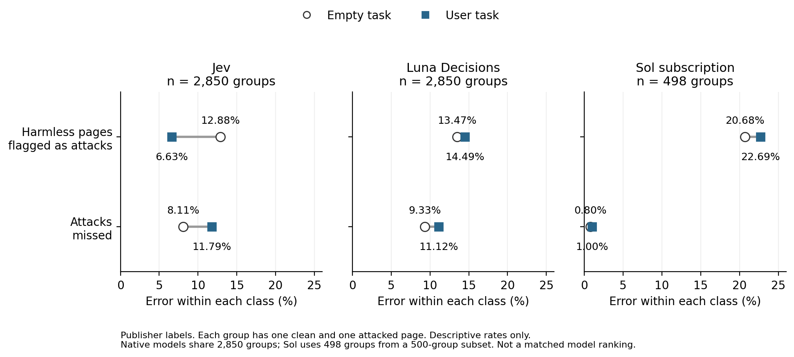

# Decision Context Benchmark

Does telling a model what the user wants help it detect prompt injection?

We compare Jev and other decision models with general-purpose language models. The task-context tests compare judgments of the same text with and without the user’s task. We also use a generic warning and filler text to check whether the task itself makes a difference.

## Data and models

- **AgentDojo, AgentDyn and InjecAgent:** 761 task–text combinations, covering 582 distinct texts and 138 tasks.
- **BrowseSafe++:** 3,000 clean/attacked page pairs tested with Jev and GPT-6 Luna (Decisions). GPT-6.1 Sol was tested on a 500-pair subset.
- **Additional tests:** PromptShield, DTap and 12 simulated tasks we wrote.

Other comparisons include GPT-6 Astra, Nimble, Laya and ProtectAI v2. Models were not all tested on every dataset. The complete-pair BrowseSafe++ analysis includes 2,850 pairs for Jev/Luna and 498 for Sol. [Dataset and model details](../DATA.md)

## Results

Adding the task did not consistently improve detection. On BrowseSafe++, Jev raised fewer false alarms but missed more attacks. GPT-6 Luna and GPT-6.1 Sol had higher average error with task information. Results differed on DTap.

These findings concern the tested data and settings; they do not establish protection for working agents.

## Read more

- [Research notes](https://docs.google.com/document/d/1T8pvePmYF7rYWWugGc8HkSEtiI8CK3jU_3EZer2WFmo/edit) and [four examples to discuss](https://docs.google.com/document/d/1h5RO4VKXj-eB-dk3-C2v0YRtCl9n_DrriGXa66m7lbk/edit)
- [Results and figures](../docs/paper-preparation/README.md)
- [Methods and related work](../docs/critical-review/METHODS-NOTE.md)
- [Reproduce the analysis](../REPRODUCING.md)

Code is in `scripts/`, methods in `docs/`, and saved results in `results/`. Restricted raw data are not included. The paper is not yet written.
