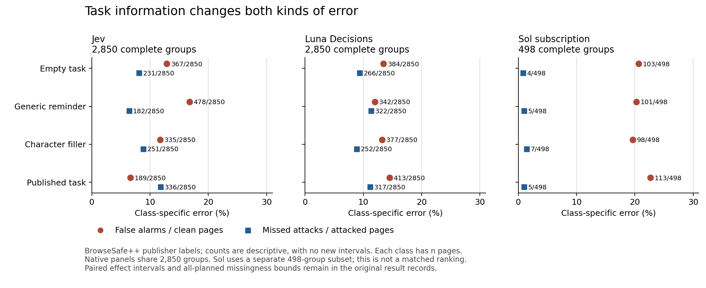

# Evidence review

**A focused five-page report is defensible as a controlled comparison against publisher labels.** Task information changes decisions; it does not consistently improve detection, and a lower average error can hide more missed attacks. No agent-security benefit was demonstrated.

- [Initial review and claim-to-evidence table](INITIAL-REVIEW.md), saved before edits at `8f4bc476`. **Its seed concern F2 was rejected after independent checking; use the resolution log for final dispositions.**
- [Findings and resolutions](RESOLUTION.md).
- [Closest prior work and review methods](METHODS-NOTE.md).
- [Offline verification, including the declared interval seed](../../results/critical-review/offline-verification-v1.json).
- [Portable replay receipt](../../results/critical-review/portable-verification-v2.json) and [sampling provenance](../../results/critical-review/core-rate-sampling-v1.json).
- [Human-review instructions](HUMAN-REVIEW.md). The packet is prepared; human judgments remain blank.



This new figure displays saved counts only. Native panels use the same 2,850 groups; Sol uses its separate 498-group complete cohort. Refer to the [v7 effects](../../results/study-v7-execution/README.md) and [Sol effects](../../results/subscription-followup-execution/README.md) for paired intervals and all-planned missingness bounds. This is not a matched model ranking.

## Reproduce offline

Use Python 3.13 with the repository CI pins: NumPy 2.4.4, SciPy 1.17.1 and PyYAML 6.0.3. Figure rendering additionally uses Matplotlib (the saved figure receipt records the installed version). These commands make no network or model requests and need no credentials. Run from the review branch root; use a new output path if inputs change.

```sh
python -m scripts.critical_review.verify --output /tmp/dcb-compact-review.json
python -m unittest discover -s tests/critical_review -v
python -m scripts.critical_review.figure --output /tmp/dcb-review-figure
```

The compact check replays the saved analyses exactly, using archived original draws for one secondary rate table as explained below. It independently recomputes nine effects and their missing-error bounds, checks repeat counts and the pilot unit-format issue, and tests both seeds for all 72 second-source rate intervals. It is not a fresh raw-provenance verification.

The saved full receipt also uses the retained local checkouts. Set these paths to the prepared evidence locations on your machine:

```sh
python -m scripts.critical_review.verify \
  --followup-root '/path/to/Decision Context Benchmark Followup' \
  --v7-root '/path/to/Decision Context Benchmark Plan' \
  --output /tmp/dcb-full-review.json
```

This additionally checks selected raw transports against their hashes and independently parses their answers, verifies candidate identity across the core/source plan conditions, and recomputes all six v7 means, Holm tests and missing-error bounds from 48,000 retained parsed first attempts. It does not repeat the earlier full-journal or source-acquisition audit. Full raw evidence and full human-review source text remain ignored; a clone alone can reproduce the compact calculations, not those local checks.

## Rejected seed concern

Initial finding F2 misread lowercase `seed` as module constant `SEED`. The frozen `_metrics` implementation uses its supplied seed correctly. The `rate_seed_verification` section of the new receipt independently reproduces all 72 second-source FPR/FNR/BER intervals with the declared extension seed. It also compares the core seed as a counterfactual check; that seed is not what the frozen code uses.

**No seed, metadata or numerical correction is needed.** The initial review remains preserved as requested; the resolution log records the rejected finding. The new explicit-seed implementation is an audit check, not a replacement result pipeline.

## Portable replay

A later Linux CI check found a separate reproducibility limitation: direct seeded core replay differs in four endpoints for archived Jev's all-planned available-output task-condition FNR/BER intervals, by at most **0.0294 percentage points**. This is not F2's rejected seed hypothesis. Counts, means, bounds and primary effects match exactly. The initial full local receipt remains preserved.

The new `core-rate-sampling-v1.npz` stores the original 20,000 multinomial count vectors for that one table, regenerated in the original environment and accepted only after exact agreement with every original endpoint. Its metadata binds the frozen source rows, code, seed, support, category counts and draw hash. The portable verifier computes rates/quantiles from those saved draws, then requires exact equality of the full result. It does not widen a numerical tolerance, change an original value or patch the frozen estimator. It reports direct seeded-regeneration differences separately and fails if any other field differs.

This distinction matters because [NumPy's random-stream compatibility policy](https://numpy.org/doc/stable/reference/random/compatibility.html) limits its guarantee to the same build, environment and machine; a package-version pin alone does not guarantee identical transformed random draws. CI diagnostics compare support/probability bits, raw PCG64 values and multinomial draw hashes. These locate the portability issue without claiming to identify the exact CPU/compiler instruction responsible. This is an offline replay aid submitted in the draft PR for coordinator review, not a replacement statistical result.
