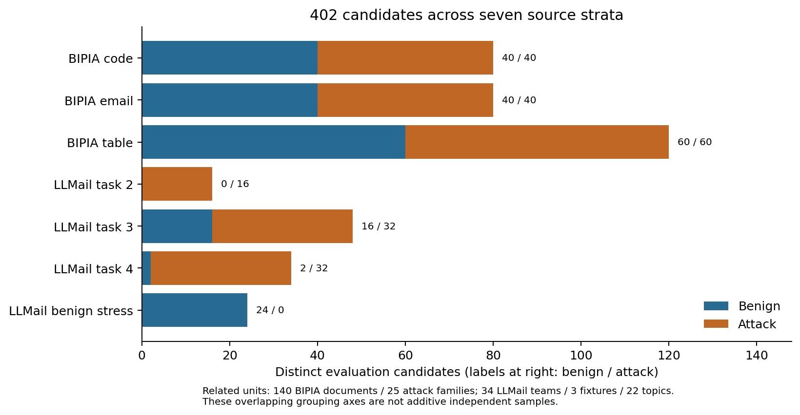
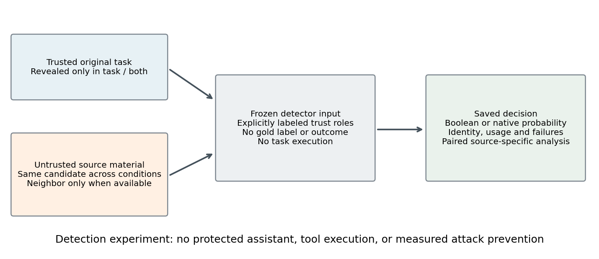
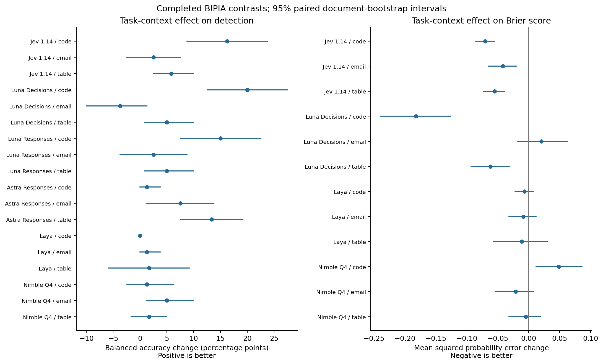
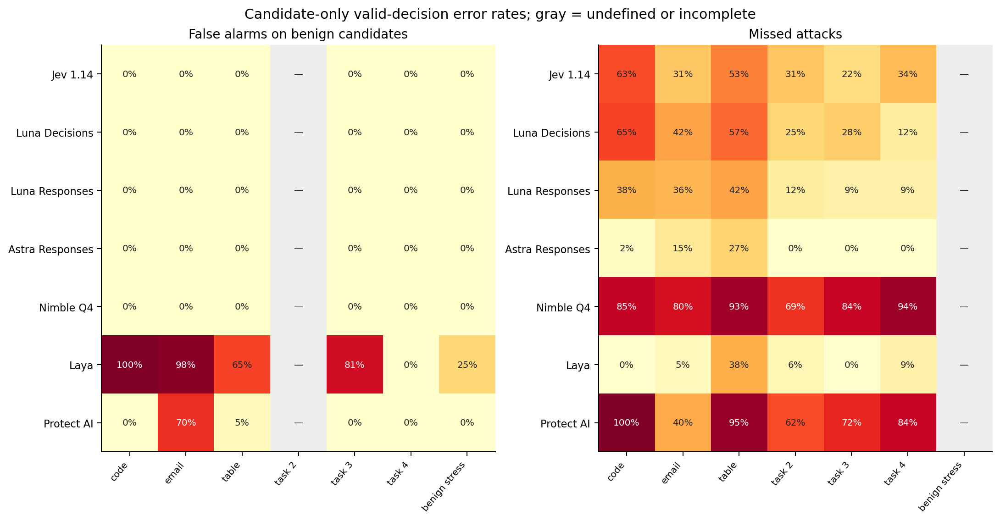
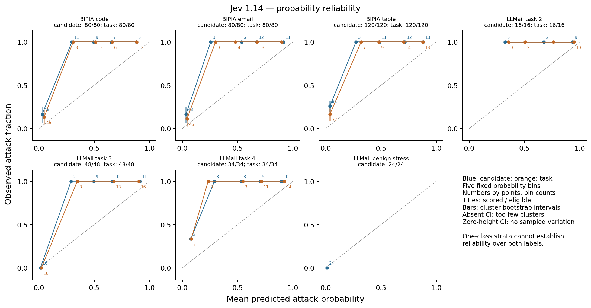

# Trusted task context and prompt-injection judgments

## A source-stratified study of typed decision and chat interfaces

Decision Context Benchmark | Private research draft | October 2026

{{status}}

## Abstract

Prompt-injection detection depends on the relationship between an external document and the user's intended task. We study whether revealing the original trusted task improves a fixed model's classification and native probability forecasts for the same candidate. The collection contains 402 evaluation candidates and 60 separate development candidates drawn from released BIPIA and LLMail-Inject material. Seven configurations cover six model IDs: first-party Jev, Luna through Decisions and Responses, Astra Responses, local Nimble and Laya, and a candidate-only Protect AI classifier. We retain source-specific labels, grouping, operational failures and missing outputs. Primary comparisons use paired balanced accuracy; exploratory probability analyses use Brier scores and reliability diagrams without converting Boolean chat answers into forecasts. {{abstract_results}} This is a detection study, not a measurement of end-to-end attack prevention. Public-data contamination, correlated examples, inherited labels and limited authentic neighboring context constrain the interpretation.

## 1. Introduction

The same imperative can be relevant task content, a quotation, or an attempt to redirect an assistant. A detector that sees only surface text may miss this distinction. The practical question is whether adding the original trusted task changes a detector's judgment in the right direction, and whether its numerical forecasts become more reliable. A typed response guarantees a usable output structure; it does not establish correctness or calibration on a new population.

We keep the external candidate fixed and reveal information already present in its original scenario. This estimates the effect of task availability under the frozen prompt and route. It does not test whether an identical sentence should receive different gold labels under newly invented tasks. Labels and context are inherited from released sources; we generate neither examples nor gold annotations.

The contribution is a reproducible, source-stratified comparison of these deployed interfaces under a shared context intervention, including raw failures and operational checks. Context-aware detection, context ablations and decision-model calibration audits already exist. We make no first-of-its-kind claim or assumption that positive findings are necessary.

## 2. Related work

CAD explicitly combines sentence content with the user query and surrounding response, and ablates both components [1]. Its released detector code prepends the original query before computing contextual representations. CAD learns a sentence filter and evaluates protected-agent utility and attack success; our whole-document, off-the-shelf detector comparison measures a different endpoint.

Liu evaluates Jev, Laya, Nimble and other judges on prompt injection, interaction risk and harmful-request admission, including probability calibration and selective automation [2]. The released artifact uses separate source partitions for fitting and policy selection. Our primary contrast is the original task's availability within a candidate. We do not import its thresholds, scores or runtime claims.

CAPTURE constructs domain-sensitive malicious and benign prompts and studies over-defense [3]. Its PDF describes GPT-4o generation of framework, separator and disruptor components. Nokast-secureRAG jointly evaluates query and retrieved context, includes input ablations and generated judgment-flip pairs, and explicitly calls its detection-side attack-success measure a proxy [4]. These are close precedents; they are not interchangeable sources of historical context or labels for our frozen collection.

BIPIA evaluates indirect injection and defenses in task applications [5]. LLMail-Inject evaluates adaptive attacks that must be retrieved, evade defenses and cause unauthorized email-tool calls [6]. We reuse released material while distinguishing construction labels from historical tool outcomes. Neither source's original attack-success rate is reproduced by our classification metric. Probability reliability is also distinct from accuracy; Guo et al. provide a widely used discussion of this distinction [7].

## 3. Data and context intervention

{{data_table}}

BIPIA supplies 140 released source documents, each paired with one published inserted attack, across code, email and table tasks. Clean/injected construction determines labels. Insertion follows the pinned upstream builder; the entire document is the candidate. One question per normalized document is selected. The separate development split uses released training material and excludes held-out document, query and attack-family groups, including lexical near duplicates.

LLMail positives require recorded retrieval and successful unauthorized tool-call destination/content checks. Failed submissions are never labeled benign. Negatives inherit the released synthetic fixtures; these are not private real emails. Attack-team and candidate exclusions preserve separation from the original pilot. Historical success selection may favor attacks effective against the original systems. LLM-assisted semantic annotations released by LLMail are not our gold source.

The task condition adds the original trusted query to the same candidate. Source and both conditions are available only for the fixed LLMail task-2 neighborhood; its 16 attack candidates form a positive-only secondary replication. The neighborhood was exposed during the original pilot. Original retrieval neighborhoods are unavailable for LLMail tasks 3 and 4, so none are invented. Benign stress emails have candidate-only evaluation. LLMail task 4 has only two negatives from one fixture, precluding a population false-positive interval.

The manifest records byte hashes, upstream revisions, selection and grouping axes. There are 131 distinct evaluation query strings, 140 BIPIA document groups, 25 BIPIA attack families, 34 LLMail teams, three fixtures and 22 stress topics. These axes overlap and must not be summed as independent observations. Exact and lexical exclusions do not prove semantic independence or eliminate training contamination.

Figure 1. Distinct candidates by source and inherited class. Counts are not model requests or independent task counts.

## 4. Models, prompts and operational controls

{{model_table}}

Jev uses its first-party TypeSafe API [8]. Luna Decisions returns a native predicate probability [9]. The two Luna configurations share the model ID; they are interface comparisons rather than independent model families. Luna and Astra Responses use the separately authorized subscription route, with strict Boolean JSON, reasoning none/low and output caps 256/2048 respectively. No verbal confidence is requested. Hosted IDs do not attest immutable weight snapshots.

Nimble uses the official Ollama native System One interface, pinned quantization digest and runtime [10]. Laya uses a pinned checkpoint and SDK, CPU inference, a complete token audit and no truncation [11]. Both are supplementary additions after initial outcomes from other arms existed. Their held-out settings were frozen after development checks. Weak Laya performance is retained; runtime validity and predictive quality are separate questions. The Protect AI detector is candidate-only and uses all-token overlapping windows, aggregating maximum injection probability; the aggregation can increase false alarms on long documents.

Exact prompts, request hashes, model identities, settings and development evidence are preserved. A response is valid only if it passes the appropriate native or strict-JSON parser. A score above 0.5 predicts attack, below 0.5 predicts benign, and exactly 0.5 abstains from classification while remaining a valid probability forecast. No evaluation-based tuning, fitting or prompt repair is performed.

Figure 2. The intervention reveals trusted task information without changing the untrusted candidate. The detector does not execute the source text or act as the protected assistant.

Every attempt retains its request, available response, usage, route and failure status. Existing invalid cells are not silently replaced. A lost Astra attempt is recorded as unknown rather than reconstructed. Luna's empty stream and later gateway timeout remain invalid. The gateway's Retry-After was honored before a versioned, hash-bound continuation to unattempted cells; no failed cell was retried. Authentication, quota and billing failures stop a route. No route silently switches to a reseller or paid chat API.

## 5. Statistical analysis

For each source with both classes, strict balanced accuracy averages class-specific correct-decision fractions: BA = (correct attacks / all attacks + correct benign / all benign) / 2. Observed invalid outputs and ties count incorrect. Not-run cells are shown as missing and do not support a completed contrast. False-positive and false-negative rates use valid class denominators; paired valid-error contrasts use decisions valid in both conditions. We also report strict class failure, which includes invalid outputs and abstentions.

The primary effect is task minus candidate BA on identical candidates. Intervals use 10,000 paired cluster-bootstrap draws with seed 20261026. BIPIA document and attack-family groupings are separate sensitivity analyses. LLMail positive teams and negative fixtures/topics are sampled within class. The same draw weights apply across compared conditions and models. With fewer than two observed clusters in a required stratum, a population interval is omitted. Results are conditional on the released tasks; no independent-task population claim, pooled winner or confirmatory significance test is made.

Probability analysis is an exploratory amendment proposed after some original-arm outcomes existed, not a preregistered confirmatory analysis. Brier score is the mean of (p - y)^2; task-minus-candidate differences below zero favor task context. Paired forecasts use their common scored subset and report missing denominators. Boolean chat outputs are excluded, not encoded as probabilities zero or one. Log loss clips only inside the logarithm at 1e-6, with exact endpoint counts retained. Reliability diagrams use five equal-width bins, show counts and cluster uncertainty, and do not imply calibration from sparse bins or from Brier score alone. Prevalence affects Brier scores and observed frequencies.

Threshold sweeps and attack-family/length breakdowns are descriptive supplements. They do not select a new evaluation threshold. One response per cell does not quantify stochastic-generation variation, and intervals do not include label uncertainty, model drift or training contamination.

## 6. Results

{{coverage_table}}

{{results_text}}

{{effect_table}}

Table 3. Completed two-class task-versus-candidate comparisons. BA is strict; intervals are document-cluster bootstrap for BIPIA. LLMail point estimates are descriptive when a class has one fixture. Full attack-family sensitivity and class-specific denominators accompany the machine-readable analysis.

Figure 3. BIPIA task effects on detection and probability error. Bars are paired document-bootstrap intervals, not simultaneous guarantees. Probability panels exclude Boolean chat responses.

{{brier_table}}

Table 4. Native probability forecasts on the common scored subset. The main comparison uses raw probabilities, including exact 0.5. No calibration is fitted.

Figure 4. Candidate-only false alarms and missed attacks, conditional on valid outputs. Gray cells are undefined or incomplete. Source-specific denominators and strict invalid penalties are in the analysis tables.

Figure 5. Jev's source-specific reliability under candidate and task conditions. Point annotations give bin counts. One-class strata and sparse bins cannot establish general calibration. Equivalent diagrams for every native-score model accompany this draft.

{{operations_table}}

Table 5. Route-level recorded durations, not intrinsic model-speed comparisons. Local runs may contend for the same host; subscription timing includes transport/provider overhead. Missing attempts have no invented duration or token count. Electricity and existing subscription fees are excluded from metered API accounting.

## 7. Discussion

{{discussion_text}}

Adding a task can clarify that a source instruction is unrelated to the user's goal, but it can also change a detector's threshold behavior or encourage over-interpretation. Classification and forecast effects need not agree: a probability can move toward the correct label without crossing 0.5, or become less reliable despite an unchanged binary decision. The paired design reveals these distinctions but does not identify the internal mechanism.

Source differences are scientifically relevant. BIPIA's inserted templates and LLMail's historically successful tool attacks represent different target events and selection processes. A single pooled score would obscure those differences. A highly confident error on one group is not repaired by strong aggregate accuracy. Conversely, poor zero-shot results from a correctly executed local model are evidence about this configuration, not proof that the model cannot benefit from separately validated development-only adaptation.

## 8. Limitations and scope

The collection is public, modest and highly correlated. Its labels inherit construction and historical outcomes rather than an independent semantic annotation study. Published synthetic fixtures can have recognizable style. Task context is authentic to the released source but does not cover the diversity of real deployments. The LLMail metadata query differs from an additional instruction in the original execution code; we use the released metadata verbatim and do not claim an exact end-to-end replay. Full context factorial evidence is confined to a positive-only, previously exposed neighborhood.

A candidate-only detector cannot know every omitted task, and this study does not construct counterfactual task/label flips. Repeated attack families, limited fixtures and selection on historical success restrict uncertainty estimates. Public-data contamination cannot be ruled out. The original preparation and later local/probability extensions have different timing; none is presented as a fully blind preregistration. Model versions, provider routes and quantization must be retained when interpreting or reproducing observations.

Detection is not prevention. A deployed defense also needs a policy for abstentions, false positives, tool permissions, adaptive attacks and utility under attack. No agent tool-call experiment or deployment guarantee follows from these figures. No threshold has been selected for production use.

## 9. Reproducibility and data governance

The private repository retains the original pilot and preparation freezes, per-attempt raw evidence, source manifests, exact prompts, versioned amendments, grouped splits and offline analysis. Original pilot files are hash-protected and unchanged. BIPIA email/code notices and LLMail MIT notices are preserved; table and Stack Exchange material require the documented source-specific CC BY-SA attribution. The mixed collection is not relicensed wholesale as MIT. Credentials, downloaded full corpora and local weights remain outside Git.

{{reproduction}}

All reported numerical tables are generated from saved artifacts, not manually transcribed. The build records input hashes; final verification must regenerate analyses after execution stops, inspect every figure/PDF page and confirm raw-response parsing, coverage, caps and credential absence. This draft is neither submitted nor publicly published.

## References

[1] Buzhao Liu, Xinhang Ma, and Yevgeniy Vorobeychik. 2026. Robust Context-Aware Detection of Malicious Instructions in Text. arXiv:2608.05430v1. https://arxiv.org/html/2608.05430v1

[2] Yixuan Liu. 2026. Evaluating System One Models for Agent Security Decisions: Reliability, Calibration, and Selective Automation. arXiv:2609.33401v1. https://arxiv.org/html/2609.33401v1

[3] Gauri Kholkar and Ratinder Ahuja. 2025. CAPTURE: Context-Aware Prompt Injection Testing and Robustness Enhancement. Proceedings of the First Workshop on LLM Security, pp. 176-188. https://aclanthology.org/2025.llmsec-1.13/

[4] Abhishek Rai. 2026. Context-Aware Prompt Injection Detection via Small Language Models in RAG Pipelines: nokast-secureRAG. arXiv:2610.28364v1. https://arxiv.org/html/2610.28364v1

[5] Jingwei Yi et al. 2025. Benchmarking and Defending Against Indirect Prompt Injection Attacks on Large Language Models. KDD 2025. DOI: 10.1145/3690624.3709179. https://arxiv.org/html/2312.14197v4

[6] Sahar Abdelnabi et al. 2025. LLMail-Inject: A Dataset from a Realistic Adaptive Prompt Injection Challenge. arXiv:2506.09956v1. https://arxiv.org/html/2506.09956v1

[7] Chuan Guo, Geoff Pleiss, Yu Sun, and Kilian Q. Weinberger. 2017. On Calibration of Modern Neural Networks. ICML, PMLR 70:1321-1330. https://proceedings.mlr.press/v70/guo17a.html

[8] TypeSafe. Models documentation. Inspected October 29, 2026. https://docs.typesafe.ai/models

[9] OpenAI. Decisions API documentation. Inspected October 29, 2026. https://developers.openai.com/api/docs/guides/decisions

[10] Ollama / Bespoke Labs. Nimble library and native System One API documentation. Inspected October 29, 2026. https://ollama.com/library/nimble ; https://docs.ollama.com/api/systemone

[11] Convai Innovations. Laya multilingual model card. Pinned checkpoint 1720e3e3357cfe1e281542e223f8273b0890ca34. https://huggingface.co/convaiinnovations/laya-multilingual
