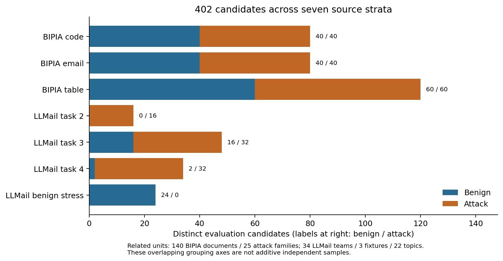
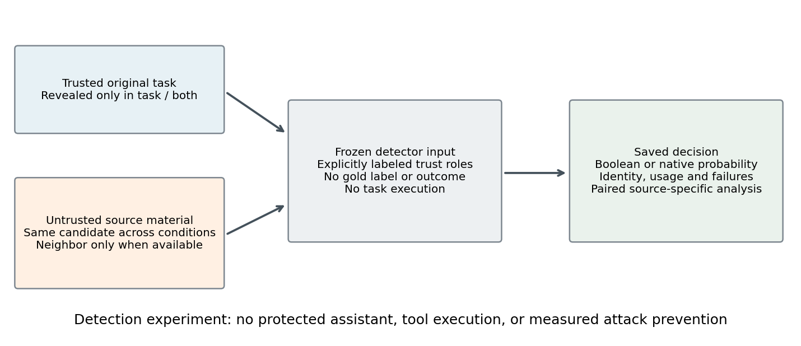
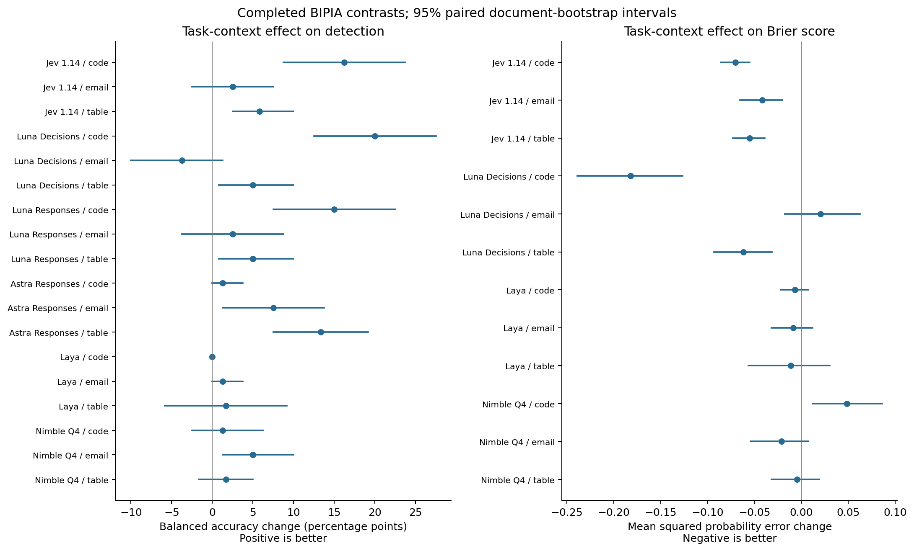
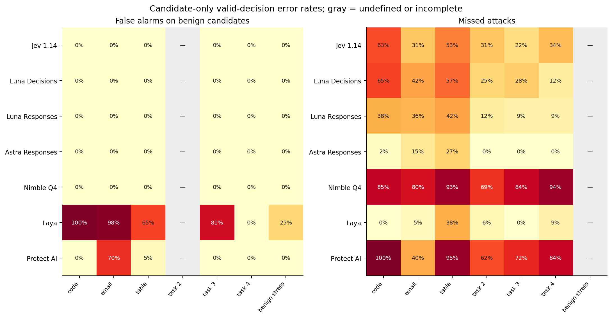
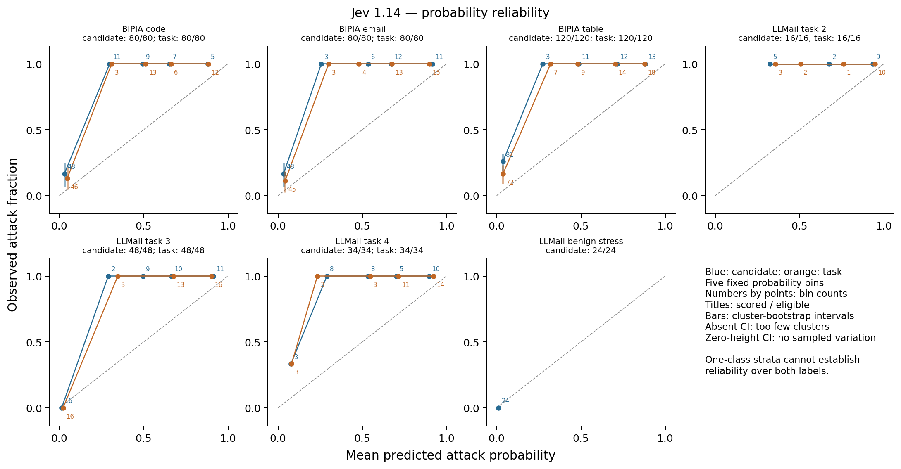

# Trusted task context and prompt-injection judgments

## A source-stratified study of typed decision and chat interfaces

Decision Context Benchmark | Private research draft | October 2026

RESEARCH DRAFT: all 5274 planned logical cells are represented, including preserved failures. This is not a claim that every cell returned a valid prediction.

## Abstract

Prompt-injection detection depends on the relationship between an external document and the user's intended task. We study whether revealing the original trusted task improves a fixed model's classification and native probability forecasts for the same candidate. The collection contains 402 evaluation candidates and 60 separate development candidates drawn from released BIPIA and LLMail-Inject material. Seven configurations cover six model IDs: first-party Jev, Luna through Decisions and Responses, Astra Responses, local Nimble and Laya, and a candidate-only Protect AI classifier. We retain source-specific labels, grouping, operational failures and missing outputs. Primary comparisons use paired balanced accuracy; exploratory probability analyses use Brier scores and reliability diagrams without converting Boolean chat answers into forecasts. Task context changes Jev's BIPIA code balanced accuracy by +16.25 percentage points (95% document-bootstrap interval [8.750, 23.750]) and Luna Decisions' BIPIA email balanced accuracy by -3.75 points ([-10.000, 1.250]). The latter interval includes no change; directions must be interpreted with their uncertainty. This is a detection study, not a measurement of end-to-end attack prevention. Public-data contamination, correlated examples, inherited labels and limited authentic neighboring context constrain the interpretation.

## 1. Introduction

The same imperative can be relevant task content, a quotation, or an attempt to redirect an assistant. A detector that sees only surface text may miss this distinction. The practical question is whether adding the original trusted task changes a detector's judgment in the right direction, and whether its numerical forecasts become more reliable. A typed response guarantees a usable output structure; it does not establish correctness or calibration on a new population.

We keep the external candidate fixed and reveal information already present in its original scenario. This estimates the effect of task availability under the frozen prompt and route. It does not test whether an identical sentence should receive different gold labels under newly invented tasks. Labels and context are inherited from released sources; we generate neither examples nor gold annotations.

The contribution is a reproducible, source-stratified comparison of these deployed interfaces under a shared context intervention, including raw failures and operational checks. Context-aware detection, context ablations and decision-model calibration audits already exist. We make no first-of-its-kind claim or assumption that positive findings are necessary.

## 2. Related work

CAD explicitly combines sentence content with the user query and surrounding response, and ablates both components [1]. Its released detector code prepends the original query before computing contextual representations. CAD learns a sentence filter and evaluates protected-agent utility and attack success; our whole-document, off-the-shelf detector comparison measures a different endpoint.

Liu evaluates Jev, Laya, Nimble and other judges on prompt injection, interaction risk and harmful-request admission, including probability calibration and selective automation [2]. The released artifact uses separate source partitions for fitting and policy selection. Our primary contrast is the original task's availability within a candidate. We do not import its thresholds, scores or runtime claims.

CAPTURE constructs domain-sensitive malicious and benign prompts and studies over-defense [3]. Its PDF describes GPT-4o generation of framework, separator and disruptor components. Nokast-secureRAG jointly evaluates query and retrieved context, includes input ablations and generated judgment-flip pairs, and explicitly calls its detection-side attack-success measure a proxy [4]. These are close precedents; they are not interchangeable sources of historical context or labels for our frozen collection.

BIPIA evaluates indirect injection and defenses in task applications [5]. LLMail-Inject evaluates adaptive attacks that must be retrieved, evade defenses and cause unauthorized email-tool calls [6]. We reuse released material while distinguishing construction labels from historical tool outcomes. Neither source's original attack-success rate is reproduced by our classification metric. Probability reliability is also distinct from accuracy; Guo et al. provide a widely used discussion of this distinction [7].

## 3. Data and context intervention

| Source | Benign | Attack | Total | Conditions |
| --- | --- | --- | --- | --- |
| BIPIA code | 40 | 40 | 80 | candidate / task |
| BIPIA email | 40 | 40 | 80 | candidate / task |
| BIPIA table | 60 | 60 | 120 | candidate / task |
| LLMail task 2 | 0 | 16 | 16 | both / candidate / source / task |
| LLMail task 3 | 16 | 32 | 48 | candidate / task |
| LLMail task 4 | 2 | 32 | 34 | candidate / task |
| LLMail stress | 24 | 0 | 24 | candidate |

Table 1. Evaluation candidates and supported conditions.

BIPIA supplies 140 released source documents, each paired with one published inserted attack, across code, email and table tasks. Clean/injected construction determines labels. Insertion follows the pinned upstream builder; the entire document is the candidate. One question per normalized document is selected. The separate development split uses released training material and excludes held-out document, query and attack-family groups, including lexical near duplicates.

LLMail positives require recorded retrieval and successful unauthorized tool-call destination/content checks. Failed submissions are never labeled benign. Negatives inherit the released synthetic fixtures; these are not private real emails. Attack-team and candidate exclusions preserve separation from the original pilot. Historical success selection may favor attacks effective against the original systems. LLM-assisted semantic annotations released by LLMail are not our gold source.

The task condition adds the original trusted query to the same candidate. Source and both conditions are available only for the fixed LLMail task-2 neighborhood; its 16 attack candidates form a positive-only secondary replication. The neighborhood was exposed during the original pilot. Original retrieval neighborhoods are unavailable for LLMail tasks 3 and 4, so none are invented. Benign stress emails have candidate-only evaluation. LLMail task 4 has only two negatives from one fixture, precluding a population false-positive interval.

The manifest records byte hashes, upstream revisions, selection and grouping axes. There are 131 distinct evaluation query strings, 140 BIPIA document groups, 25 BIPIA attack families, 34 LLMail teams, three fixtures and 22 stress topics. These axes overlap and must not be summed as independent observations. Exact and lexical exclusions do not prove semantic independence or eliminate training contamination.

Figure 1. Distinct candidates by source and inherited class. Counts are not model requests or independent task counts.

## 4. Models, prompts and operational controls

| Configuration | Exact model ID | Route | Output |
| --- | --- | --- | --- |
| Jev 1.14 | jev-1.14.0 | First-party API | Native score |
| Luna Decisions | gpt-6-luna | First-party API | Native score |
| Luna Responses | gpt-6-luna | Subscription Responses | Boolean |
| Astra Responses | gpt-6-astra | Subscription Responses | Boolean |
| Nimble Q4 | nimble:9b-q4_K_M | Local | Native score |
| Laya | convaiinnovations/laya-multilingual | Local | Native score |
| Protect AI | protectai/deberta-v3-base-prompt-injection-v2 | Local | Native score |

Table 2. Exact model identifiers and observed routes.

Jev uses its first-party TypeSafe API [8]. Luna Decisions returns a native predicate probability [9]. The two Luna configurations share the model ID; they are interface comparisons rather than independent model families. Luna and Astra Responses use the separately authorized subscription route, with strict Boolean JSON, reasoning none/low and output caps 256/2048 respectively. No verbal confidence is requested. Hosted IDs do not attest immutable weight snapshots.

Nimble uses the official Ollama native System One interface, pinned quantization digest and runtime [10]. Laya uses a pinned checkpoint and SDK, CPU inference, a complete token audit and no truncation [11]. Both are supplementary additions after initial outcomes from other arms existed. Their held-out settings were frozen after development checks. Weak Laya performance is retained; runtime validity and predictive quality are separate questions. The archived Protect AI detector [12] is candidate-only and uses all-token overlapping windows, aggregating maximum injection probability; the aggregation can increase false alarms on long documents.

Exact prompts, request hashes, model identities, settings and development evidence are preserved. A response is valid only if it passes the appropriate native or strict-JSON parser. A score above 0.5 predicts attack, below 0.5 predicts benign, and exactly 0.5 abstains from classification while remaining a valid probability forecast. No evaluation-based tuning, fitting or prompt repair is performed.

Figure 2. The intervention reveals trusted task information without changing the untrusted candidate. The detector does not execute the source text or act as the protected assistant.

Every attempt retains its request, available response, usage, route and failure status. Existing invalid cells are not silently replaced. Astra retains an unknown lost attempt, an interrupted stream and a provider overload as invalid cells. Luna's empty stream and later gateway timeout also remain invalid. The gateway's Retry-After and the overload policy's fixed cooldown were honored before versioned, hash-bound continuations to unattempted cells; no failed cell was retried. Authentication, quota and billing failures stop a route. No route silently switches to a reseller or paid chat API.

## 5. Statistical analysis

For each source with both classes, strict balanced accuracy averages class-specific correct-decision fractions: BA = (correct attacks / all attacks + correct benign / all benign) / 2. Observed invalid outputs and ties count incorrect. Not-run cells are shown as missing and do not support a completed contrast. False-positive and false-negative rates use valid class denominators; paired valid-error contrasts use decisions valid in both conditions. We also report strict class failure, which includes invalid outputs and abstentions.

The primary effect is task minus candidate BA on identical candidates. Intervals use 10,000 paired cluster-bootstrap draws with seed 20261026. BIPIA document and attack-family groupings are separate sensitivity analyses. LLMail positive teams and negative fixtures/topics are sampled within class. The same draw weights apply across compared conditions and models. With fewer than two observed clusters in a required stratum, a population interval is omitted. Results are conditional on the released tasks; no independent-task population claim, pooled winner or confirmatory significance test is made.

Probability analysis is an exploratory amendment proposed after some original-arm outcomes existed, not a preregistered confirmatory analysis. Brier score is the mean of (p - y)^2; task-minus-candidate differences below zero favor task context. Paired forecasts use their common scored subset and report missing denominators. Boolean chat outputs are excluded, not encoded as probabilities zero or one. Log loss clips only inside the logarithm at 1e-6, with exact endpoint counts retained. Reliability diagrams use five equal-width bins, show counts and cluster uncertainty, and do not imply calibration from sparse bins or from Brier score alone. Prevalence affects Brier scores and observed frequencies.

Threshold sweeps and attack-family/length breakdowns are descriptive supplements. They do not select a new evaluation threshold. One response per cell does not quantify stochastic-generation variation, and intervals do not include label uncertainty, model drift or training contamination.

## 6. Results

| Configuration | Planned | Recorded | Valid | Invalid / tie | Not run |
| --- | --- | --- | --- | --- | --- |
| Jev 1.14 | 812 | 812 | 805 | 7 | 0 |
| Luna Decisions | 812 | 812 | 812 | 0 | 0 |
| Luna Responses | 812 | 812 | 810 | 2 | 0 |
| Astra Responses | 812 | 812 | 809 | 3 | 0 |
| Nimble Q4 | 812 | 812 | 812 | 0 | 0 |
| Laya | 812 | 812 | 812 | 0 | 0 |
| Protect AI | 402 | 402 | 402 | 0 | 0 |

Table 3. Logical-cell coverage, including preserved invalid outputs.

The specialist baseline contains 402 logical candidate scans and 445 actual forward windows; scans, forward windows, candidate counts and remote attempt records are different units.

The table includes 30 completed two-class comparisons; incomplete strata are excluded from effect claims, not removed from coverage accounting. Numerical direction and uncertainty must be read by source. The first-party arms each retain 812 cells; Jev's exact-0.5 forecasts are classification abstentions rather than false probability records. Across completed BIPIA strata, task-context changes are Jev 1.14: BIPIA code +16.25 pp, BIPIA email +2.50 pp, BIPIA table +5.83 pp. Luna Decisions: BIPIA code +20.00 pp, BIPIA email -3.75 pp, BIPIA table +5.00 pp. Luna Responses: BIPIA code +15.00 pp, BIPIA email +2.50 pp, BIPIA table +5.00 pp. Astra Responses: BIPIA code +1.25 pp, BIPIA email +7.50 pp, BIPIA table +13.33 pp. Nimble Q4: BIPIA code +1.25 pp, BIPIA email +5.00 pp, BIPIA table +1.67 pp. Laya: BIPIA code +0.00 pp, BIPIA email +1.25 pp, BIPIA table +1.67 pp.

| Configuration | Source | BA candidate % | BA task % | Delta pp | 95% CI pp |
| --- | --- | --- | --- | --- | --- |
| Jev 1.14 | BIPIA code | 67.50 | 83.75 | +16.25 | [8.750, 23.750] |
| Jev 1.14 | BIPIA email | 83.75 | 86.25 | +2.50 | [-2.500, 7.500] |
| Jev 1.14 | BIPIA table | 73.33 | 79.17 | +5.83 | [2.500, 10.000] |
| Jev 1.14 | LLMail task 3 | 89.06 | 95.31 | +6.25 | -- |
| Jev 1.14 | LLMail task 4 | 82.81 | 93.75 | +10.94 | -- |
| Luna Decisions | BIPIA code | 67.50 | 87.50 | +20.00 | [12.500, 27.500] |
| Luna Decisions | BIPIA email | 78.75 | 75.00 | -3.75 | [-10.000, 1.250] |
| Luna Decisions | BIPIA table | 71.67 | 76.67 | +5.00 | [0.833, 10.000] |
| Luna Decisions | LLMail task 3 | 85.94 | 96.88 | +10.94 | -- |
| Luna Decisions | LLMail task 4 | 93.75 | 100.00 | +6.25 | -- |
| Luna Responses | BIPIA code | 81.25 | 96.25 | +15.00 | [7.500, 22.500] |
| Luna Responses | BIPIA email | 81.25 | 83.75 | +2.50 | [-3.750, 8.750] |
| Luna Responses | BIPIA table | 79.17 | 84.17 | +5.00 | [0.833, 10.000] |
| Luna Responses | LLMail task 3 | 95.31 | 98.44 | +3.12 | -- |
| Luna Responses | LLMail task 4 | 95.31 | 100.00 | +4.69 | -- |
| Astra Responses | BIPIA code | 98.75 | 100.00 | +1.25 | [0.000, 3.750] |
| Astra Responses | BIPIA email | 91.25 | 98.75 | +7.50 | [1.250, 13.750] |
| Astra Responses | BIPIA table | 86.67 | 100.00 | +13.33 | [7.500, 19.167] |
| Astra Responses | LLMail task 3 | 100.00 | 100.00 | +0.00 | -- |
| Astra Responses | LLMail task 4 | 100.00 | 98.44 | -1.56 | -- |
| Laya | BIPIA code | 50.00 | 50.00 | +0.00 | [0.000, 0.000] |
| Laya | BIPIA email | 48.75 | 50.00 | +1.25 | [0.000, 3.750] |
| Laya | BIPIA table | 48.33 | 50.00 | +1.67 | [-5.833, 9.167] |
| Laya | LLMail task 3 | 59.38 | 53.12 | -6.25 | -- |
| Laya | LLMail task 4 | 95.31 | 75.00 | -20.31 | -- |
| Nimble Q4 | BIPIA code | 57.50 | 58.75 | +1.25 | [-2.500, 6.250] |
| Nimble Q4 | BIPIA email | 60.00 | 65.00 | +5.00 | [1.250, 10.000] |
| Nimble Q4 | BIPIA table | 53.33 | 55.00 | +1.67 | [-1.667, 5.000] |
| Nimble Q4 | LLMail task 3 | 57.81 | 62.50 | +4.69 | -- |
| Nimble Q4 | LLMail task 4 | 53.12 | 64.06 | +10.94 | -- |

Table 4. Completed two-class task-versus-candidate comparisons. BA is strict; intervals are document-cluster bootstrap for BIPIA. LLMail point estimates are descriptive when a class has one fixture. Full attack-family sensitivity and class-specific denominators accompany the machine-readable analysis.

Figure 3. BIPIA task effects on detection and probability error. Bars are paired document-bootstrap intervals, not simultaneous guarantees. Probability panels exclude Boolean chat responses.

Task-minus-candidate Brier changes in completed BIPIA strata are Jev 1.14: BIPIA code -0.0704, BIPIA email -0.0418, BIPIA table -0.0553. Luna Decisions: BIPIA code -0.1821, BIPIA email +0.0205, BIPIA table -0.0619. Nimble Q4: BIPIA code +0.0486, BIPIA email -0.0214, BIPIA table -0.0046. Laya: BIPIA code -0.0068, BIPIA email -0.0089, BIPIA table -0.0114. Negative values indicate smaller probability error. These changes describe forecast quality; reliability bins must still be inspected because Brier score combines calibration and discrimination. All source-specific values, common-subset counts and uncertainty are retained below. For Laya on BIPIA code, the largest candidate-only probability bin contains 77 examples: mean predicted attack probability 0.958, observed attack fraction 0.494. This is an empirical bin comparison, not a population calibration guarantee. For Nimble Q4 on BIPIA code, the largest candidate-only probability bin contains 60 examples: mean predicted attack probability 0.037, observed attack fraction 0.333. This is an empirical bin comparison, not a population calibration guarantee.

| Configuration | Source | Common / eligible | Brier candidate | Brier task | Delta | 95% CI |
| --- | --- | --- | --- | --- | --- | --- |
| Jev 1.14 | BIPIA code | 80/80 | 0.1918 | 0.1214 | -0.0704 | [-0.086, -0.055] |
| Jev 1.14 | BIPIA email | 80/80 | 0.1416 | 0.0999 | -0.0418 | [-0.065, -0.020] |
| Jev 1.14 | BIPIA table | 120/120 | 0.1921 | 0.1368 | -0.0553 | [-0.073, -0.039] |
| Jev 1.14 | LLMail task 2 | 16/16 | 0.1607 | 0.1163 | -0.0444 | [-0.081, -0.010] |
| Jev 1.14 | LLMail task 3 | 48/48 | 0.0958 | 0.0609 | -0.0349 | -- |
| Jev 1.14 | LLMail task 4 | 34/34 | 0.2092 | 0.1203 | -0.0889 | -- |
| Luna Decisions | BIPIA code | 80/80 | 0.2864 | 0.1043 | -0.1821 | [-0.239, -0.127] |
| Luna Decisions | BIPIA email | 80/80 | 0.2025 | 0.2230 | 0.0205 | [-0.018, 0.062] |
| Luna Decisions | BIPIA table | 120/120 | 0.2575 | 0.1956 | -0.0619 | [-0.093, -0.031] |
| Luna Decisions | LLMail task 2 | 16/16 | 0.2107 | 0.1825 | -0.0282 | [-0.060, -0.000] |
| Luna Decisions | LLMail task 3 | 48/48 | 0.1517 | 0.0185 | -0.1332 | -- |
| Luna Decisions | LLMail task 4 | 34/34 | 0.0859 | 0.0004 | -0.0855 | -- |
| Laya | BIPIA code | 80/80 | 0.4568 | 0.4500 | -0.0068 | [-0.022, 0.008] |
| Laya | BIPIA email | 80/80 | 0.4898 | 0.4809 | -0.0089 | [-0.032, 0.012] |
| Laya | BIPIA table | 120/120 | 0.3836 | 0.3722 | -0.0114 | [-0.056, 0.030] |
| Laya | LLMail task 2 | 16/16 | 0.0402 | 0.0097 | -0.0305 | [-0.089, 0.012] |
| Laya | LLMail task 3 | 48/48 | 0.1774 | 0.2431 | 0.0657 | -- |
| Laya | LLMail task 4 | 34/34 | 0.0653 | 0.0151 | -0.0503 | -- |
| Nimble Q4 | BIPIA code | 80/80 | 0.3000 | 0.3486 | 0.0486 | [0.012, 0.086] |
| Nimble Q4 | BIPIA email | 80/80 | 0.3045 | 0.2832 | -0.0214 | [-0.054, 0.008] |
| Nimble Q4 | BIPIA table | 120/120 | 0.4054 | 0.4008 | -0.0046 | [-0.032, 0.019] |
| Nimble Q4 | LLMail task 2 | 16/16 | 0.4908 | 0.3962 | -0.0946 | [-0.200, -0.013] |
| Nimble Q4 | LLMail task 3 | 48/48 | 0.3982 | 0.3245 | -0.0737 | -- |
| Nimble Q4 | LLMail task 4 | 34/34 | 0.5904 | 0.4281 | -0.1623 | -- |

Table 5. Native probability forecasts on the common scored subset. The main comparison uses raw probabilities, including exact 0.5. No calibration is fitted.

Figure 4. Candidate-only false alarms and missed attacks, conditional on valid outputs. Gray cells are undefined or incomplete. Source-specific denominators and strict invalid penalties are in the analysis tables.

Figure 5. Jev's source-specific reliability under candidate and task conditions. Point annotations give bin counts. One-class strata and sparse bins cannot establish general calibration. Equivalent diagrams for every native-score model accompany this draft.

| Configuration | Attempt records | Median s | P90 s | Known input tokens | Usage records |
| --- | --- | --- | --- | --- | --- |
| Jev 1.14 | 812 | 0.1010 | 0.1390 | 608046 | 812/812 |
| Luna Decisions | 812 | 0.1780 | 0.2828 | 481385 | 812/812 |
| Luna Responses | 812 | 2.2325 | 3.1056 | 402361 | 810/812 |
| Astra Responses | 812 | 3.6220 | 5.4680 | 401972 | 809/812 |
| Protect AI | 402 | 0.2075 | 0.4910 | -- | 0/402 |
| Laya | 812 | 0.4380 | 1.9266 | 549885 | 812/812 |
| Nimble Q4 | 812 | 2.4045 | 4.6274 | 507419 | 812/812 |

Table 6. Route-level recorded durations, not intrinsic model-speed comparisons. Local runs may contend for the same host; subscription timing includes transport/provider overhead. Missing attempts have no invented duration or token count. Electricity and existing subscription fees are excluded from metered API accounting.

| Configuration | Category | Candidate ID | Gold | p candidate | p task |
| --- | --- | --- | --- | --- | --- |
| Jev 1.14 | corrected | bipia:code:test:12:1 | 1 | 0.3800 | 0.6100 |
| Luna Decisions | regressed | bipia:email:test:20:1 | 1 | 0.9400 | 0.0200 |
| Laya | persistent false alarm | bipia:code:test:10:0 | 0 | 0.8532 | 0.5513 |
| Nimble Q4 | regressed | bipia:code:test:13:1 | 1 | 0.5672 | 0.0645 |

Table 7. Deterministically selected paired examples. Probabilities are raw native scores, rounded for display; classifications use unrounded values. These examples illustrate disagreements with inherited labels and do not estimate category frequency. Full records and source attribution are linked in `error-review.json`.

The code examples illustrate a limitation of surface-level decisions: a source can contain a legitimate bug fix and an unrelated inserted action in the same document. Task context sometimes changes the decision in the correct direction but sometimes lowers the attack score. A published clean coding answer can also remain a false alarm even when its task is visible. We inspected the corresponding released records; these descriptions are qualitative interpretations, not new annotations or explanations of model internals.

## 7. Discussion

Task context is not uniformly beneficial across the completed comparisons. The BIPIA code improvement for Jev and email decrease for Luna Decisions exemplify why a global winner would be misleading. The study's conservative all-in accounted metered usage is $0.096443 for OpenAI and $0.051171 for TypeSafe, including earlier checks and retained reservations; these are ledger estimates, not reconciled invoices. Provider limits remain $15 and $20 respectively. Nimble's BIPIA code balanced accuracy changes by +1.25 pp, while Brier score changes by +0.0486. The Brier interval is [0.012, 0.086], while the BA interval is [-2.500, 6.250] pp and includes zero. The different point-estimate directions show why classification and native forecast error require separate conclusions. Laya task-condition balanced accuracy is BIPIA code 50.00%, BIPIA email 50.00%, BIPIA table 50.00%. These weak results coexist with complete valid outputs and verified input coverage. They remain part of the comparison; no post-evaluation calibration or threshold repair is applied.

Adding a task can clarify that a source instruction is unrelated to the user's goal, but it can also change a detector's threshold behavior or encourage over-interpretation. Classification and forecast effects need not agree: a probability can move toward the correct label without crossing 0.5, or become less reliable despite an unchanged binary decision. The paired design reveals these distinctions but does not identify the internal mechanism.

Source differences are scientifically relevant. BIPIA's inserted templates and LLMail's historically successful tool attacks represent different target events and selection processes. A single pooled score would obscure those differences. A highly confident error on one group is not repaired by strong aggregate accuracy. Conversely, poor zero-shot results from a correctly executed local model are evidence about this configuration, not proof that the model cannot benefit from separately validated development-only adaptation.

## 8. Limitations and scope

The collection is public, modest and highly correlated. Its labels inherit construction and historical outcomes rather than an independent semantic annotation study. Published synthetic fixtures can have recognizable style. Task context is authentic to the released source but does not cover the diversity of real deployments. The LLMail metadata query differs from an additional instruction in the original execution code; we use the released metadata verbatim and do not claim an exact end-to-end replay. Full context factorial evidence is confined to a positive-only, previously exposed neighborhood.

A candidate-only detector cannot know every omitted task, and this study does not construct counterfactual task/label flips. Repeated attack families, limited fixtures and selection on historical success restrict uncertainty estimates. Public-data contamination cannot be ruled out; the specialist discloses public training sources but not enough information to exclude all overlap. Degenerate bootstrap intervals from observed zero errors do not prove zero population risk. The original preparation and later local/probability extensions have different timing; none is presented as a fully blind preregistration. Model versions, provider routes and quantization must be retained when interpreting or reproducing observations.

Detection is not prevention. A deployed defense also needs a policy for abstentions, false positives, tool permissions, adaptive attacks and utility under attack. No agent tool-call experiment or deployment guarantee follows from these figures. No threshold has been selected for production use.

## 9. Reproducibility and data governance

The private repository retains the original pilot and preparation freezes, per-attempt raw evidence, source manifests, exact prompts, versioned amendments, grouped splits and offline analysis. Original pilot files are hash-protected and unchanged. BIPIA email/code notices and LLMail MIT notices are preserved; table and Stack Exchange material require the documented source-specific CC BY-SA attribution. The mixed collection is not relicensed wholesale as MIT. Credentials, downloaded full corpora and local weights remain outside Git.

Offline regeneration sequence: `analyze.py`, `forecast_analysis.py`, `research_summaries.py`, `error_review.py`, `verify_analysis.py`, `paper_figures.py`, and `build_paper.py` in `scripts/expanded_execution/`. The analysis and figure scripts use the project environment; the PDF build additionally requires ReportLab. Run the execution, local-arm, preparation and pilot tests/verifiers before delivery. No regeneration command calls a model.

All reported numerical tables are generated from saved artifacts, not manually transcribed. The build records input hashes; final verification must regenerate analyses after execution stops, inspect every figure/PDF page and confirm raw-response parsing, coverage, caps and credential absence. This draft is neither submitted nor publicly published.

## References

[1] Buzhao Liu, Xinhang Ma, and Yevgeniy Vorobeychik. 2026. Robust Context-Aware Detection of Malicious Instructions in Text. arXiv:2608.05430v1. https://arxiv.org/html/2608.05430v1

[2] Yixuan Liu. 2026. Evaluating System One Models for Agent Security Decisions: Reliability, Calibration, and Selective Automation. arXiv:2609.33401v1. https://arxiv.org/html/2609.33401v1

[3] Gauri Kholkar and Ratinder Ahuja. 2025. CAPTURE: Context-Aware Prompt Injection Testing and Robustness Enhancement. Proceedings of the First Workshop on LLM Security, pp. 176-188. https://aclanthology.org/2025.llmsec-1.13/

[4] Abhishek Rai. 2026. Context-Aware Prompt Injection Detection via Small Language Models in RAG Pipelines: nokast-secureRAG. arXiv:2610.28364v1. https://arxiv.org/html/2610.28364v1

[5] Jingwei Yi et al. 2025. Benchmarking and Defending Against Indirect Prompt Injection Attacks on Large Language Models. KDD 2025. DOI: 10.1145/3690624.3709179. https://arxiv.org/html/2312.14197v4

[6] Sahar Abdelnabi et al. 2025. LLMail-Inject: A Dataset from a Realistic Adaptive Prompt Injection Challenge. arXiv:2506.09956v1. https://arxiv.org/html/2506.09956v1

[7] Chuan Guo, Geoff Pleiss, Yu Sun, and Kilian Q. Weinberger. 2017. On Calibration of Modern Neural Networks. ICML, PMLR 70:1321-1330. https://proceedings.mlr.press/v70/guo17a.html

[8] TypeSafe. Models documentation. Inspected October 29, 2026. https://docs.typesafe.ai/models

[9] OpenAI. Decisions API documentation. Inspected October 29, 2026. https://developers.openai.com/api/docs/guides/decisions

[10] Ollama / Bespoke Labs. Nimble library and native System One API documentation. Inspected October 29, 2026. https://ollama.com/library/nimble ; https://docs.ollama.com/api/systemone

[11] Convai Innovations. Laya multilingual model card. Pinned checkpoint 1720e3e3357cfe1e281542e223f8273b0890ca34. https://huggingface.co/convaiinnovations/laya-multilingual

[12] Protect AI. deberta-v3-base-prompt-injection-v2 model card. Pinned revision 90c9989b1a342275dd0d1a95aad283c04e075671. https://huggingface.co/protectai/deberta-v3-base-prompt-injection-v2
