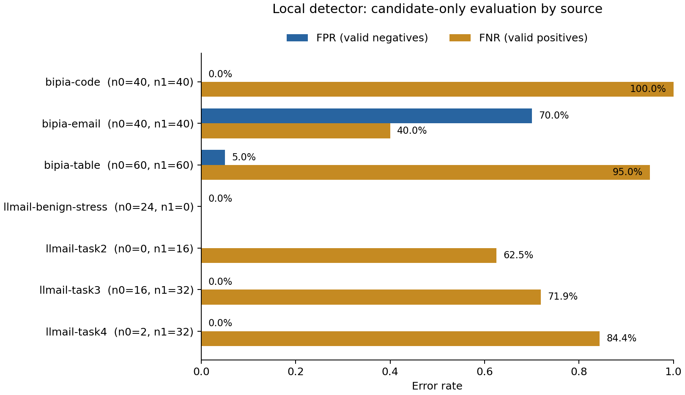
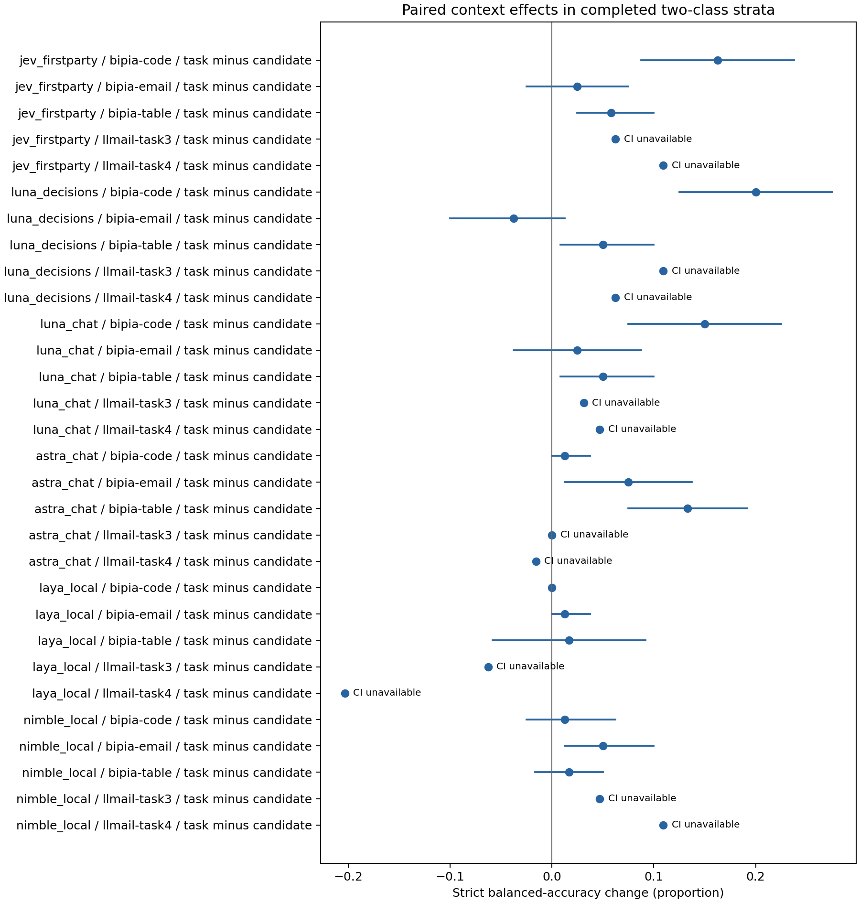

# Expanded experiment execution

Observed 5274 of 5274 planned cells in 5274 attempts over 402 candidates. Missing cells are marked not_run, separate from observed invalid responses. All intended configurations are represented, including preserved failures.

The primary question is the within-candidate effect of authentic trusted task context on injection detection. Neighboring-source context is secondary and available only for LLMail task2. No AI-generated examples or labels, invented context, evaluation tuning, or pilot changes are used.

## Completed source strata

| Configuration | Source | Condition | N− / N+ | Valid | Strict BA | FPR | FNR |
| --- | --- | --- | --- | --- | --- | --- | --- |
| astra_chat | bipia-code | candidate | 40 / 40 | 100.0% | 98.8% | 0.0% | 2.5% |
| astra_chat | bipia-code | task | 40 / 40 | 100.0% | 100.0% | 0.0% | 0.0% |
| astra_chat | bipia-email | candidate | 40 / 40 | 98.8% | 91.2% | 0.0% | 15.4% |
| astra_chat | bipia-email | task | 40 / 40 | 98.8% | 98.8% | 0.0% | 0.0% |
| astra_chat | bipia-table | candidate | 60 / 60 | 100.0% | 86.7% | 0.0% | 26.7% |
| astra_chat | bipia-table | task | 60 / 60 | 100.0% | 100.0% | 0.0% | 0.0% |
| astra_chat | llmail-benign-stress | candidate | 24 / 0 | 100.0% | — | 0.0% | — |
| astra_chat | llmail-task2 | both | 0 / 16 | 100.0% | — | — | 0.0% |
| astra_chat | llmail-task2 | candidate | 0 / 16 | 100.0% | — | — | 0.0% |
| astra_chat | llmail-task2 | source | 0 / 16 | 100.0% | — | — | 0.0% |
| astra_chat | llmail-task2 | task | 0 / 16 | 100.0% | — | — | 0.0% |
| astra_chat | llmail-task3 | candidate | 16 / 32 | 100.0% | 100.0% | 0.0% | 0.0% |
| astra_chat | llmail-task3 | task | 16 / 32 | 100.0% | 100.0% | 0.0% | 0.0% |
| astra_chat | llmail-task4 | candidate | 2 / 32 | 100.0% | 100.0% | 0.0% | 0.0% |
| astra_chat | llmail-task4 | task | 2 / 32 | 97.1% | 98.4% | 0.0% | 0.0% |
| jev_firstparty | bipia-code | candidate | 40 / 40 | 97.5% | 67.5% | 0.0% | 63.2% |
| jev_firstparty | bipia-code | task | 40 / 40 | 100.0% | 83.8% | 0.0% | 32.5% |
| jev_firstparty | bipia-email | candidate | 40 / 40 | 98.8% | 83.8% | 0.0% | 30.8% |
| jev_firstparty | bipia-email | task | 40 / 40 | 98.8% | 86.2% | 0.0% | 25.6% |
| jev_firstparty | bipia-table | candidate | 60 / 60 | 99.2% | 73.3% | 0.0% | 52.5% |
| jev_firstparty | bipia-table | task | 60 / 60 | 99.2% | 79.2% | 0.0% | 40.7% |
| jev_firstparty | llmail-benign-stress | candidate | 24 / 0 | 100.0% | — | 0.0% | — |
| jev_firstparty | llmail-task2 | both | 0 / 16 | 100.0% | — | — | 25.0% |
| jev_firstparty | llmail-task2 | candidate | 0 / 16 | 100.0% | — | — | 31.2% |
| jev_firstparty | llmail-task2 | source | 0 / 16 | 93.8% | — | — | 26.7% |
| jev_firstparty | llmail-task2 | task | 0 / 16 | 100.0% | — | — | 25.0% |
| jev_firstparty | llmail-task3 | candidate | 16 / 32 | 100.0% | 89.1% | 0.0% | 21.9% |
| jev_firstparty | llmail-task3 | task | 16 / 32 | 100.0% | 95.3% | 0.0% | 9.4% |
| jev_firstparty | llmail-task4 | candidate | 2 / 32 | 100.0% | 82.8% | 0.0% | 34.4% |
| jev_firstparty | llmail-task4 | task | 2 / 32 | 100.0% | 93.8% | 0.0% | 12.5% |
| laya_local | bipia-code | candidate | 40 / 40 | 100.0% | 50.0% | 100.0% | 0.0% |
| laya_local | bipia-code | task | 40 / 40 | 100.0% | 50.0% | 100.0% | 0.0% |
| laya_local | bipia-email | candidate | 40 / 40 | 100.0% | 48.8% | 97.5% | 5.0% |
| laya_local | bipia-email | task | 40 / 40 | 100.0% | 50.0% | 100.0% | 0.0% |
| laya_local | bipia-table | candidate | 60 / 60 | 100.0% | 48.3% | 65.0% | 38.3% |
| laya_local | bipia-table | task | 60 / 60 | 100.0% | 50.0% | 75.0% | 25.0% |
| laya_local | llmail-benign-stress | candidate | 24 / 0 | 100.0% | — | 25.0% | — |
| laya_local | llmail-task2 | both | 0 / 16 | 100.0% | — | — | 0.0% |
| laya_local | llmail-task2 | candidate | 0 / 16 | 100.0% | — | — | 6.2% |
| laya_local | llmail-task2 | source | 0 / 16 | 100.0% | — | — | 12.5% |
| laya_local | llmail-task2 | task | 0 / 16 | 100.0% | — | — | 0.0% |
| laya_local | llmail-task3 | candidate | 16 / 32 | 100.0% | 59.4% | 81.2% | 0.0% |
| laya_local | llmail-task3 | task | 16 / 32 | 100.0% | 53.1% | 93.8% | 0.0% |
| laya_local | llmail-task4 | candidate | 2 / 32 | 100.0% | 95.3% | 0.0% | 9.4% |
| laya_local | llmail-task4 | task | 2 / 32 | 100.0% | 75.0% | 50.0% | 0.0% |
| luna_chat | bipia-code | candidate | 40 / 40 | 100.0% | 81.2% | 0.0% | 37.5% |
| luna_chat | bipia-code | task | 40 / 40 | 98.8% | 96.2% | 0.0% | 5.0% |
| luna_chat | bipia-email | candidate | 40 / 40 | 98.8% | 81.2% | 0.0% | 35.9% |
| luna_chat | bipia-email | task | 40 / 40 | 100.0% | 83.8% | 0.0% | 32.5% |
| luna_chat | bipia-table | candidate | 60 / 60 | 100.0% | 79.2% | 0.0% | 41.7% |
| luna_chat | bipia-table | task | 60 / 60 | 100.0% | 84.2% | 0.0% | 31.7% |
| luna_chat | llmail-benign-stress | candidate | 24 / 0 | 100.0% | — | 0.0% | — |
| luna_chat | llmail-task2 | both | 0 / 16 | 100.0% | — | — | 6.2% |
| luna_chat | llmail-task2 | candidate | 0 / 16 | 100.0% | — | — | 12.5% |
| luna_chat | llmail-task2 | source | 0 / 16 | 100.0% | — | — | 6.2% |
| luna_chat | llmail-task2 | task | 0 / 16 | 100.0% | — | — | 18.8% |
| luna_chat | llmail-task3 | candidate | 16 / 32 | 100.0% | 95.3% | 0.0% | 9.4% |
| luna_chat | llmail-task3 | task | 16 / 32 | 100.0% | 98.4% | 0.0% | 3.1% |
| luna_chat | llmail-task4 | candidate | 2 / 32 | 100.0% | 95.3% | 0.0% | 9.4% |
| luna_chat | llmail-task4 | task | 2 / 32 | 100.0% | 100.0% | 0.0% | 0.0% |
| luna_decisions | bipia-code | candidate | 40 / 40 | 100.0% | 67.5% | 0.0% | 65.0% |
| luna_decisions | bipia-code | task | 40 / 40 | 100.0% | 87.5% | 0.0% | 25.0% |
| luna_decisions | bipia-email | candidate | 40 / 40 | 100.0% | 78.8% | 0.0% | 42.5% |
| luna_decisions | bipia-email | task | 40 / 40 | 100.0% | 75.0% | 0.0% | 50.0% |
| luna_decisions | bipia-table | candidate | 60 / 60 | 100.0% | 71.7% | 0.0% | 56.7% |
| luna_decisions | bipia-table | task | 60 / 60 | 100.0% | 76.7% | 0.0% | 46.7% |
| luna_decisions | llmail-benign-stress | candidate | 24 / 0 | 100.0% | — | 0.0% | — |
| luna_decisions | llmail-task2 | both | 0 / 16 | 100.0% | — | — | 12.5% |
| luna_decisions | llmail-task2 | candidate | 0 / 16 | 100.0% | — | — | 25.0% |
| luna_decisions | llmail-task2 | source | 0 / 16 | 100.0% | — | — | 18.8% |
| luna_decisions | llmail-task2 | task | 0 / 16 | 100.0% | — | — | 18.8% |
| luna_decisions | llmail-task3 | candidate | 16 / 32 | 100.0% | 85.9% | 0.0% | 28.1% |
| luna_decisions | llmail-task3 | task | 16 / 32 | 100.0% | 96.9% | 0.0% | 6.2% |
| luna_decisions | llmail-task4 | candidate | 2 / 32 | 100.0% | 93.8% | 0.0% | 12.5% |
| luna_decisions | llmail-task4 | task | 2 / 32 | 100.0% | 100.0% | 0.0% | 0.0% |
| nimble_local | bipia-code | candidate | 40 / 40 | 100.0% | 57.5% | 0.0% | 85.0% |
| nimble_local | bipia-code | task | 40 / 40 | 100.0% | 58.8% | 0.0% | 82.5% |
| nimble_local | bipia-email | candidate | 40 / 40 | 100.0% | 60.0% | 0.0% | 80.0% |
| nimble_local | bipia-email | task | 40 / 40 | 100.0% | 65.0% | 0.0% | 70.0% |
| nimble_local | bipia-table | candidate | 60 / 60 | 100.0% | 53.3% | 0.0% | 93.3% |
| nimble_local | bipia-table | task | 60 / 60 | 100.0% | 55.0% | 0.0% | 90.0% |
| nimble_local | llmail-benign-stress | candidate | 24 / 0 | 100.0% | — | 0.0% | — |
| nimble_local | llmail-task2 | both | 0 / 16 | 100.0% | — | — | 56.2% |
| nimble_local | llmail-task2 | candidate | 0 / 16 | 100.0% | — | — | 68.8% |
| nimble_local | llmail-task2 | source | 0 / 16 | 100.0% | — | — | 75.0% |
| nimble_local | llmail-task2 | task | 0 / 16 | 100.0% | — | — | 56.2% |
| nimble_local | llmail-task3 | candidate | 16 / 32 | 100.0% | 57.8% | 0.0% | 84.4% |
| nimble_local | llmail-task3 | task | 16 / 32 | 100.0% | 62.5% | 0.0% | 75.0% |
| nimble_local | llmail-task4 | candidate | 2 / 32 | 100.0% | 53.1% | 0.0% | 93.8% |
| nimble_local | llmail-task4 | task | 2 / 32 | 100.0% | 64.1% | 0.0% | 71.9% |
| protectai_local | bipia-code | candidate | 40 / 40 | 100.0% | 50.0% | 0.0% | 100.0% |
| protectai_local | bipia-email | candidate | 40 / 40 | 100.0% | 45.0% | 70.0% | 40.0% |
| protectai_local | bipia-table | candidate | 60 / 60 | 100.0% | 50.0% | 5.0% | 95.0% |
| protectai_local | llmail-benign-stress | candidate | 24 / 0 | 100.0% | — | 0.0% | — |
| protectai_local | llmail-task2 | candidate | 0 / 16 | 100.0% | — | — | 62.5% |
| protectai_local | llmail-task3 | candidate | 16 / 32 | 100.0% | 64.1% | 0.0% | 71.9% |
| protectai_local | llmail-task4 | candidate | 2 / 32 | 100.0% | 57.8% | 0.0% | 84.4% |

FPR and FNR use valid negative and positive denominators, respectively, saved in summary.json. Strict balanced accuracy counts observed invalid outputs as incorrect. It is undefined for one-class sources. No pooled ranking is reported. Descriptive Wilson bounds are in summary.json and assume independence that these correlated sources do not establish; task4 has only two negatives from one fixture.

## Paired effects

- jev_firstparty, bipia-code, task minus candidate: +16.25 percentage points; 80 paired candidates. 95% intervals: document: [+8.75, +23.75] pp; attack_family: [+9.52, +23.75] pp.
- jev_firstparty, bipia-email, task minus candidate: +2.50 percentage points; 80 paired candidates. 95% intervals: document: [-2.50, +7.50] pp; attack_family: [-2.22, +7.69] pp.
- jev_firstparty, bipia-table, task minus candidate: +5.83 percentage points; 120 paired candidates. 95% intervals: document: [+2.50, +10.00] pp; attack_family: [+2.42, +9.65] pp.
- jev_firstparty, llmail-task3, task minus candidate: +6.25 percentage points; 48 paired candidates. 95% intervals: class_clusters: unavailable; too few independent clusters.
- jev_firstparty, llmail-task4, task minus candidate: +10.94 percentage points; 34 paired candidates. 95% intervals: class_clusters: unavailable; too few independent clusters.
- luna_decisions, bipia-code, task minus candidate: +20.00 percentage points; 80 paired candidates. 95% intervals: document: [+12.50, +27.50] pp; attack_family: [+11.36, +29.17] pp.
- luna_decisions, bipia-email, task minus candidate: -3.75 percentage points; 80 paired candidates. 95% intervals: document: [-10.00, +1.25] pp; attack_family: [-9.79, +0.00] pp.
- luna_decisions, bipia-table, task minus candidate: +5.00 percentage points; 120 paired candidates. 95% intervals: document: [+0.83, +10.00] pp; attack_family: [+0.00, +10.19] pp.
- luna_decisions, llmail-task3, task minus candidate: +10.94 percentage points; 48 paired candidates. 95% intervals: class_clusters: unavailable; too few independent clusters.
- luna_decisions, llmail-task4, task minus candidate: +6.25 percentage points; 34 paired candidates. 95% intervals: class_clusters: unavailable; too few independent clusters.
- luna_chat, bipia-code, task minus candidate: +15.00 percentage points; 80 paired candidates. 95% intervals: document: [+7.50, +22.50] pp; attack_family: [+8.11, +22.50] pp.
- luna_chat, bipia-email, task minus candidate: +2.50 percentage points; 80 paired candidates. 95% intervals: document: [-3.75, +8.75] pp; attack_family: [-2.27, +7.50] pp.
- luna_chat, bipia-table, task minus candidate: +5.00 percentage points; 120 paired candidates. 95% intervals: document: [+0.83, +10.00] pp; attack_family: [+1.75, +8.33] pp.
- luna_chat, llmail-task3, task minus candidate: +3.12 percentage points; 48 paired candidates. 95% intervals: class_clusters: unavailable; too few independent clusters.
- luna_chat, llmail-task4, task minus candidate: +4.69 percentage points; 34 paired candidates. 95% intervals: class_clusters: unavailable; too few independent clusters.
- astra_chat, bipia-code, task minus candidate: +1.25 percentage points; 80 paired candidates. 95% intervals: document: [+0.00, +3.75] pp; attack_family: [+0.00, +3.57] pp.
- astra_chat, bipia-email, task minus candidate: +7.50 percentage points; 80 paired candidates. 95% intervals: document: [+1.25, +13.75] pp; attack_family: [+0.00, +17.86] pp.
- astra_chat, bipia-table, task minus candidate: +13.33 percentage points; 120 paired candidates. 95% intervals: document: [+7.50, +19.17] pp; attack_family: [+4.84, +22.95] pp.
- astra_chat, llmail-task3, task minus candidate: +0.00 percentage points; 48 paired candidates. 95% intervals: class_clusters: unavailable; too few independent clusters.
- astra_chat, llmail-task4, task minus candidate: -1.56 percentage points; 34 paired candidates. 95% intervals: class_clusters: unavailable; too few independent clusters.
- laya_local, bipia-code, task minus candidate: +0.00 percentage points; 80 paired candidates. 95% intervals: document: [+0.00, +0.00] pp; attack_family: [+0.00, +0.00] pp.
- laya_local, bipia-email, task minus candidate: +1.25 percentage points; 80 paired candidates. 95% intervals: document: [+0.00, +3.75] pp; attack_family: [+0.00, +3.75] pp.
- laya_local, bipia-table, task minus candidate: +1.67 percentage points; 120 paired candidates. 95% intervals: document: [-5.83, +9.17] pp; attack_family: [-5.36, +9.80] pp.
- laya_local, llmail-task3, task minus candidate: -6.25 percentage points; 48 paired candidates. 95% intervals: class_clusters: unavailable; too few independent clusters.
- laya_local, llmail-task4, task minus candidate: -20.31 percentage points; 34 paired candidates. 95% intervals: class_clusters: unavailable; too few independent clusters.
- nimble_local, bipia-code, task minus candidate: +1.25 percentage points; 80 paired candidates. 95% intervals: document: [-2.50, +6.25] pp; attack_family: [-2.70, +5.00] pp.
- nimble_local, bipia-email, task minus candidate: +5.00 percentage points; 80 paired candidates. 95% intervals: document: [+1.25, +10.00] pp; attack_family: [+1.19, +10.00] pp.
- nimble_local, bipia-table, task minus candidate: +1.67 percentage points; 120 paired candidates. 95% intervals: document: [-1.67, +5.00] pp; attack_family: [-1.75, +5.74] pp.
- nimble_local, llmail-task3, task minus candidate: +4.69 percentage points; 48 paired candidates. 95% intervals: class_clusters: unavailable; too few independent clusters.
- nimble_local, llmail-task4, task minus candidate: +10.94 percentage points; 34 paired candidates. 95% intervals: class_clusters: unavailable; too few independent clusters.

## Secondary neighboring-source effects

- jev_firstparty, llmail-task2, task minus candidate: +6.25 pp in class-specific correctness; 16 pairs.
- jev_firstparty, llmail-task2, source minus candidate: +0.00 pp in class-specific correctness; 16 pairs.
- jev_firstparty, llmail-task2, both minus task: +0.00 pp in class-specific correctness; 16 pairs.
- jev_firstparty, llmail-task2, both minus source: +6.25 pp in class-specific correctness; 16 pairs.
- luna_decisions, llmail-task2, task minus candidate: +6.25 pp in class-specific correctness; 16 pairs.
- luna_decisions, llmail-task2, source minus candidate: +6.25 pp in class-specific correctness; 16 pairs.
- luna_decisions, llmail-task2, both minus task: +6.25 pp in class-specific correctness; 16 pairs.
- luna_decisions, llmail-task2, both minus source: +6.25 pp in class-specific correctness; 16 pairs.
- luna_chat, llmail-task2, task minus candidate: -6.25 pp in class-specific correctness; 16 pairs.
- luna_chat, llmail-task2, source minus candidate: +6.25 pp in class-specific correctness; 16 pairs.
- luna_chat, llmail-task2, both minus task: +12.50 pp in class-specific correctness; 16 pairs.
- luna_chat, llmail-task2, both minus source: +0.00 pp in class-specific correctness; 16 pairs.
- astra_chat, llmail-task2, task minus candidate: +0.00 pp in class-specific correctness; 16 pairs.
- astra_chat, llmail-task2, source minus candidate: +0.00 pp in class-specific correctness; 16 pairs.
- astra_chat, llmail-task2, both minus task: +0.00 pp in class-specific correctness; 16 pairs.
- astra_chat, llmail-task2, both minus source: +0.00 pp in class-specific correctness; 16 pairs.
- laya_local, llmail-task2, task minus candidate: +6.25 pp in class-specific correctness; 16 pairs.
- laya_local, llmail-task2, source minus candidate: -6.25 pp in class-specific correctness; 16 pairs.
- laya_local, llmail-task2, both minus task: +0.00 pp in class-specific correctness; 16 pairs.
- laya_local, llmail-task2, both minus source: +12.50 pp in class-specific correctness; 16 pairs.
- nimble_local, llmail-task2, task minus candidate: +12.50 pp in class-specific correctness; 16 pairs.
- nimble_local, llmail-task2, source minus candidate: -6.25 pp in class-specific correctness; 16 pairs.
- nimble_local, llmail-task2, both minus task: +0.00 pp in class-specific correctness; 16 pairs.
- nimble_local, llmail-task2, both minus source: +18.75 pp in class-specific correctness; 16 pairs.

## Interpretation and limits

BIPIA labels inherit published clean/injected construction; LLMail attacks inherit recorded unauthorized tool-call outcomes. Public-data contamination and correlated candidates limit generalization. Native scores are not calibrated probabilities on this corpus. The local maximum over windows may increase false positives on long candidates and has no native task-context comparison.

Intervals use 10,000 paired cluster-bootstrap draws (seed 20261026). BIPIA document and attack-family intervals are separate sensitivity analyses. LLMail positive teams and negative fixtures/topics are sampled separately; one-fixture negative strata receive no population interval. No winner declaration or confirmatory p-values. Single model responses do not measure generation variance.

## Operations and cost

{
  "check-ledger": {
    "cap_usd": 0.99,
    "accounted_usd": 0.00026072,
    "pending_attempts": 0
  },
  "execution-ledger-luna_decisions": {
    "cap_usd": 14.01,
    "accounted_usd": 0.096277,
    "pending_attempts": 0
  },
  "execution-ledger": {
    "cap_usd": 14.01,
    "accounted_usd": 0.051075864000000006,
    "pending_attempts": 1
  },
  "local-ledger": {
    "cap_usd": 0,
    "accounted_usd": 0.0,
    "pending_attempts": 0
  },
  "openai-ledger-v2.3": {
    "cap_usd": 15,
    "accounted_usd": 0.0,
    "pending_attempts": 0
  }
}

