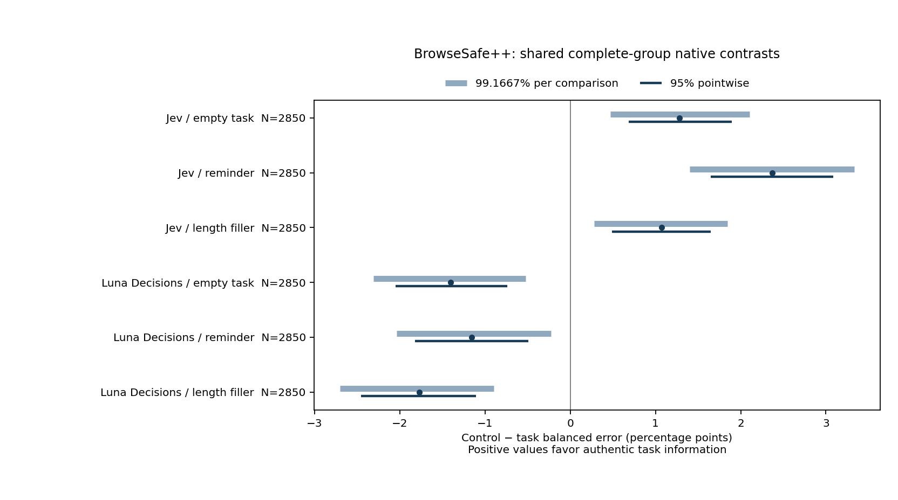

# V7 technical handoff

On the shared complete BrowseSafe++ cohort of **2,850 groups**, authentic task information reduced Jev’s source-label error and increased Luna Decisions’ error relative to all three controls. All six Holm-adjusted p-values are below .001. The all-planned missing-error bounds preserve these directions. These findings concern the locked source labels and configurations. Jev’s lower balanced error includes a tradeoff: against the empty-task control on the same 2,850 groups, false-positive rate falls from 12.88% to 6.63%, while false-negative rate rises from 8.11% to 11.79%.

Eligible collection is closed. Both native main configurations completed all 48,000 first attempts over 3,000 groups. OpenAI API credits then exhausted during the Responses comparator; remaining paid OpenAI calls were explicitly deferred. Subscription Sol had already been deferred after service failures. Jev and ProtectAI completed their remaining authorized cells. No credits, subscriptions, recharge or reset were purchased or redeemed.

## Primary contrasts

Positive control-minus-task differences favor authentic task information. Estimates below use the one shared cohort requiring valid first classifications in both native models, under all four conditions, on both pages. Intervals are approximate whole-group percentile intervals with 20,000 draws; the CSV and figure also retain the conservative 99.1667% per-comparison intervals. Two-sided paired group-mean t tests use one six-test Holm family.

| Model | Control | Error reduction with task, pp | 95% pointwise interval, pp | Holm-adjusted p | All-3,000 missing-error bounds, pp |
|---|---|---:|---|---:|---|
| Jev | Empty task | +1.28 | [+0.68, +1.89] | 0.000119 | [+0.82, +1.97] |
| Jev | Generic reminder | +2.37 | [+1.65, +3.09] | 4.98e-10 | [+2.07, +3.25] |
| Jev | Character-matched filler | +1.07 | [+0.49, +1.65] | 0.000514 | [+0.67, +1.87] |
| Luna Decisions | Empty task | -1.40 | [-2.05, -0.74] | 0.000119 | [-1.67, -1.57] |
| Luna Decisions | Generic reminder | -1.16 | [-1.82, -0.49] | 0.00075 | [-1.28, -1.12] |
| Luna Decisions | Character-matched filler | -1.77 | [-2.46, -1.11] | 1.44e-06 | [-2.08, -1.88] |

The missing-error bounds retain every known individual error and range each missing error over [0,1]. They bound the realized finite 3,000-group target; they are **not confidence intervals**. They need not contain the shared-complete estimate because the target cohort differs. Contrast-specific complete-cohort sensitivities retain the same directions; their counts and estimates are in the primary CSV.



[Reviewed planned bounds](reviewed-figures/planned-missingness-bounds.png) · [Exact primary table](tables/primary-contrasts.csv) · [Full primary analysis](primary-analysis.json) · [Same-cohort FPR/FNR decomposition](shared-primary-confusion.csv)

## Coverage and operational limits

Counts below are first confirmation calls, excluding development, audit and repeats. “OK” is a valid binary classification; exact native 0.5 ties abstain. Planned cells remain in coverage even when never sent.

| Configuration / source | Planned | OK | Ties | Failed | Unattempted |
|---|---:|---:|---:|---:|---:|
| Jev / main | 24,000 | 23,862 | 138 | 0 | 0 |
| Luna Decisions / main | 24,000 | 23,978 | 19 | 3 HTTP | 0 |
| Luna Responses / main | 4,000 | 109 | 0 | 2 missing_usage | 3,889 |
| ProtectAI / main | 1,000 | 1,000 | 0 | 0 | 0 |
| Sol subscription / main | 4,000 | 0 | 0 | 0 | 4,000 |
| Jev / PromptShield | 4,000 | 3,990 | 10 | 0 | 0 |
| Luna Decisions / PromptShield | 4,000 | 0 | 0 | 0 | 4,000 |
| Luna Responses / PromptShield | 1,000 | 0 | 0 | 0 | 1,000 |
| ProtectAI / PromptShield | 4,000 | 4,000 | 0 | 0 | 0 |
| Sol subscription / PromptShield | 1,000 | 0 | 0 | 0 | 1,000 |

The two Responses failures were HTTP200 streams with provider `insufficient_quota / credit_balance_exhausted` events. Their retained parser disposition remains `missing_usage`; no parser repair or replacement prediction was introduced. There were zero OpenAI dispatches after the credit-stop prefix. The exact original schedules were retained: only never-dispatched paid reservations were canceled at zero, while wholly deferred allocations remained unadmitted.

Source-specific error/coverage panels use their own observed cohorts and must not be read as a matched leaderboard. Main contextual matched comparisons use the locked 500-group subset, with pair-specific complete cohorts; paid Responses comparisons have only 13–14 complete groups per condition. On the locked 1,000-request PromptShield comparison, Jev and ProtectAI have 1,000 common valid rows (500 per class); Jev-minus-ProtectAI request-mean error is −21.7 pp, descriptive 95% group interval [−24.3,−19.2]. There are no additional p-values or pooled-source headline.

[Main error and coverage](reviewed-figures/browsesafe-error-coverage.png) · [External error and coverage](reviewed-figures/promptshield-error-coverage.png) · [Matched cohorts and intervals](matched-comparisons.csv) · [Score diagnostics](tables/reliability.csv)

## Separate repeated calls

All 800 planned Jev repeats were new `repeat-1` transport attempts: 797 OK and three ties. Both-valid first/repeat page counts are 200/195/197/199 for empty-task/length/reminder/task; observed classification disagreements are 4/2/1/2, or 2.00%/1.03%/0.51%/1.01%. Whole-group intervals, score changes, missingness and recorded timestamps are preserved separately. Provider response IDs were unavailable for these Jev records and were not invented. Other configurations’ planned repeats remain unattempted. No repeat replaces any primary outcome.

[Repeat stability CSV](repeat-stability.csv) · [Complete repeat evidence metadata](repeat-stability.json)

## Accounting and verification

| New v7 usage accounting, USD | OpenAI | TypeSafe |
|---|---:|---:|
| Known settled usage cost | 29.69410125 | 5.951424192 |
| Unknown-charge holds retained | 1.99528160 | 0 |
| Total conservative accounting | 31.68938285 | 5.951424192 |
| Incremental cap | 350 | 20 |

No active reservation remains. The five OpenAI holds are three native HTTP failures at 0.525 each and two failed Responses streams at 0.2101408 each. Historical-inclusive conservative totals are 38.71694205 OpenAI and 7.77900912600000006 TypeSafe; inherited literals were not rebased. These are usage-based accounting estimates and held maxima, **not verified provider invoices or balances**. Subscription/local requests have no incremental metered API dollars in this ledger.

The final audit verified 135,053 journal events; 60,186 actual attempt keys were dispatched once (60,182 current-plan attempts plus four archived pre-v7.0.2 Sol parameter failures). It checked 350,716 evidence files / 1,127,585,266 bytes. All 5,200 local classification records match the pinned token audit and complete 16,048 overlapping windows. The 8,689 post-credit cancellations are proven never-sent at zero with the exact deferral receipt; four earlier zero-cost Sol cancellations are separate. No prior outcome or unknown hold changed.

[Final accounting/evidence audit](../study-v7/execution-accounting-v7.0.8.json) · [Independent primary verification](independent-primary-verification.json) · [Independent descriptive/repeat verification](independent-descriptive-repeat-verification.json)

All 98 offline regression tests and22 CI checks passed before this handoff. Independent raw reconstruction matches the six primary means, t/Holm calculations, bootstrap endpoints, finite-cohort bounds, source metrics and matched cohorts. The final verification receipts document their exact scopes.

## Source and delivery notes

Original publisher labels, selection locks and first outcomes are unchanged. The bounded unblinded Sol audit completed 70 of 100 reviews, verified 390 literal spans and retained one unverified span. Its flags did not relabel or remove cases and are not human ground truth. Global lexical/near-duplicate component screening does not certify semantic independence, unacquired non-English bridge paths or absence from model training. Approximate sampling intervals depend on the stated group assumptions; Boolean models have no invented confidence scores.

The original frozen numerical outputs and first renders remain unchanged for reproducibility. Reviewed delivery figures repair only layout/legend/title presentation;[reviewed-render-manifest.json](reviewed-render-manifest.json) binds all unchanged inputs and new render hashes. The added rendering script is postcollection presentation code, not an inference or statistical-method revision. No manuscript, LaTeX/PDF, public release, submission or merge was produced. The canonical v6 checkout and older SLM Benchmark workspace remain untouched.

Private delivery:[draft PR #14](https://github.com/tacotuesday8888/decision-context-benchmark/pull/14). Current execution freeze:[v7.0.8manifest](../study-v7/run-manifest-confirmation-v7.0.8.json). Source/preparation details remain in[READY-TO-RUN.md](../../READY-TO-RUN.md).

Reproduction uses the retained ignored local data and current `request-plan-v7.0.2.json` (SHA 70d8606f6a3090514ac08c2c67d27f84d3cf95db18847e08a0f48cc3f4d644da), not the archived original plan. From the prepared checkout:

```sh
python -m scripts.study_v7.analyze_run --plan data/raw/study-v7/request-plan-v7.0.2.json --attempts data/raw/study-v7/execution-v1/attempts --output-dir results/study-v7-execution
python -m scripts.study_v7.repeat_analysis --plan data/raw/study-v7/request-plan-v7.0.2.json --attempts data/raw/study-v7/execution-v1/attempts --output-dir results/study-v7-execution
python -m scripts.study_v7.reviewed_figures --results results/study-v7-execution
```
