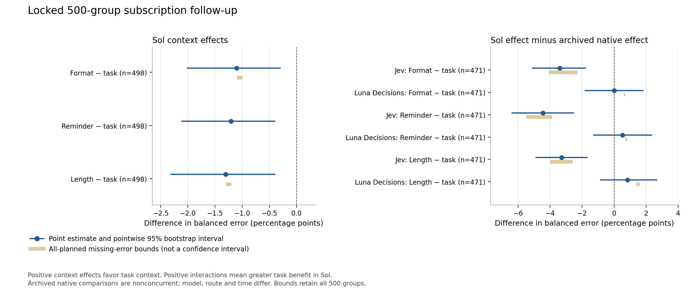

# Core follow-up experiment record

The locked 500-group follow-up is collected, analyzed and independently verified.
Task context increased Sol's balanced error by 1.10–1.31 percentage points on
the 498 groups with all eight valid Sol first outputs. This is a descriptive
result for the frozen subscription Responses configuration and selected source.

| Control minus task BER | Estimate (pp) | Pointwise 95% interval (pp) |
| --- | ---: | ---: |
| Format | -1.10 | [-2.01, -0.30] |
| Reminder | -1.20 | [-2.11, -0.40] |
| Length | -1.31 | [-2.31, -0.40] |

Positive differences favor task context. On these same 498 groups, format BER
was 10.7430% and task BER 11.8474%: false positives increased from 103 to 113
and false negatives from 4 to 5, each with a class denominator of 498.

The direct between-configuration comparisons use a separate shared cohort of
471 groups with all 24 first classification cells valid. These are paired
differences of context effects, rather than differences between significance
decisions or unpaired model error rates.

| Sol effect minus archived native effect | Format (pp) | Reminder (pp) | Length (pp) |
| --- | ---: | ---: | ---: |
| Jev | -3.40 [-5.10, -1.80] | -4.46 [-6.37, -2.55] | -3.29 [-4.88, -1.70] |
| Luna Decisions | 0.00 [-1.80, 1.80] | +0.53 [-1.27, 2.34] | +0.85 [-0.85, 2.65] |

Native results are archived and nonconcurrent. Model, route and time differ;
these comparisons do not isolate an architectural or model-size effect. The
Luna intervals crossing zero do not establish equivalence.



Both panels use percentage points and have separate horizontal scales. Dark
intervals are pointwise empirical whole-group percentile intervals from 20,000
draws. Gold segments are finite missing-error bounds for all 500 planned groups,
with a different denominator from the complete cohorts. They are not confidence
intervals. The all-500 Sol bounds are format [-1.10, -1.00]pp, reminder
[-1.20, -1.20]pp and length [-1.30, -1.20]pp. No new p-values or Holm family were
introduced; the original v7 records and primary analysis remain unchanged.

Collection accounted for 4,510 unique sent requests: 10 technical preflight,
4,000 main, 400 fresh repeats and 100 annotation-blind pair reviews. Three
service failures were retained: two main and one repeat. No failed first output
was retried or replaced. Archived native classification cells retain 26 Jev and
two Luna exact-score abstentions, which explain most complete-cohort exclusions.

The 50-group repeat packet has 399 valid repeat responses and 398 valid first
responses, yielding 397 both-valid page/condition pairs. Three predictions
changed: format 0/99, task 1/100, reminder 1/99 and length 1/99. Zero observed
changes in one condition does not prove deterministic behavior.

All 100 blind AI review packets returned valid schemas. Their injection tags
agreed with upstream source labels on 198/200 pages (TP99/TN99/FP1/FN1); 23
packets raised ambiguity flags. Of 525 evidence spans, two were not literal
input substrings. Nineteen review groups overlap the main 500. This is an AI
diagnostic, not independent human semantic gold. No labels or exclusions changed;
the earlier 70 unblinded reviews remain archived separately.

The core recorded zero new OpenAI or TypeSafe API USD. Subscription consumption
is bounded by calls, not priced here. Inherited conservative amounts and unknown
holds remain intact; this is usage accounting, not invoice verification. The
separately frozen second source and simulated-action pilot have separate outputs.
Native Luna repeat stability remains unavailable because an identical supported
subscription Decisions route was not verified; no new probe or substitution was
made.

The [analysis JSON](core-analysis-v1.json), [contrasts](core-contrasts-v1.csv),
[coverage](core-coverage-v1.csv), [repeats](core-repeat-v1.csv), and
[audit diagnostics](core-audit-v1.csv) retain denominators and sensitivities.
[Compact first outcomes](main-first-outcomes.jsonl) and
[repeat outcomes](repeat-outcomes.jsonl) support repository-only reanalysis.
[Collection closeout](collection-closeout-v1.json) and
[independent verification](independent-verification-v1.json) bind the raw hashes.
Full prompts and transports remain in the ignored local evidence store.

From the repository root, with the pinned analysis dependencies installed,
this reproduces the main estimates without network or model calls:

Exact seeded equality below was verified in the original macOS/arm64 environment.
The later [portability check](../../docs/critical-review/README.md#portable-replay)
found four secondary archived-Jev rate-interval endpoints differed on Linux/x86_64
(maximum 0.0294 percentage points), despite matching counts, primary effects and
bounds. For exact portable verification use
`python -m scripts.critical_review.verify --output /tmp/dcb-review.json` on the
review branch. It replays the original sampled draws for that one table and
reports direct seeded-regeneration differences separately; original results remain unchanged.

```python
import json
from pathlib import Path
from scripts.subscription_followup.analyze_core import analyze_main

folder = Path("results/subscription-followup-execution")
rows = [json.loads(line) for line in (folder / "main-first-outcomes.jsonl").read_text().splitlines()]
saved = json.loads((folder / "core-analysis-v1.json").read_text())
assert analyze_main(rows) == saved["main"]
```

Independent review reconstructed every main/repeat row and audit from raw
responses and checked all cohort means, class denominators, signed bounds and
exported tables. A separate 100,000-draw index bootstrap agreed within one
discrete endpoint step (0.1062pp); it did not replace the frozen 20,000-draw
production intervals.
